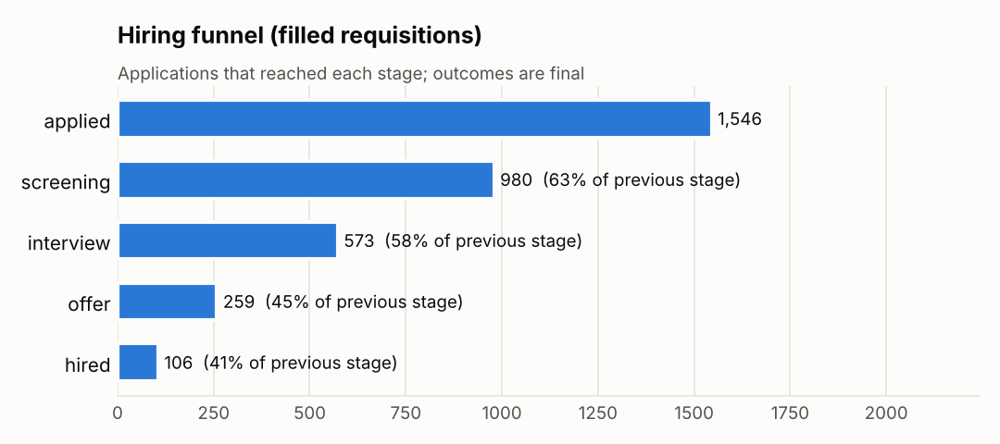
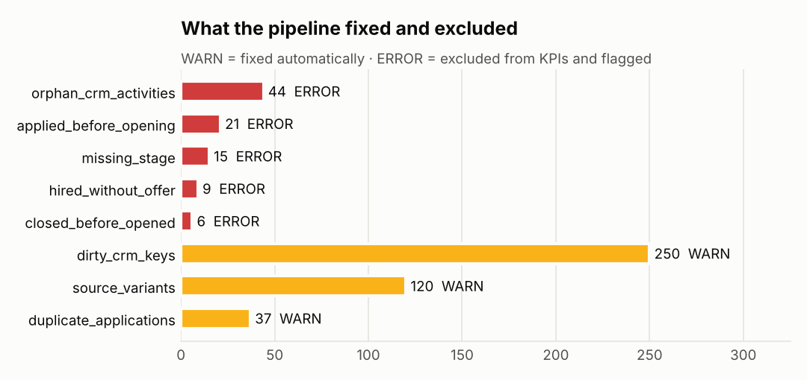
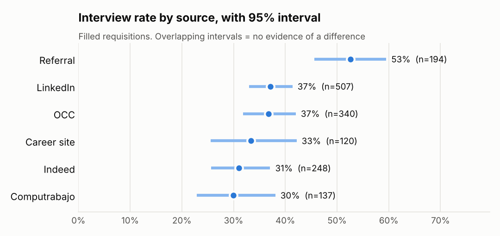
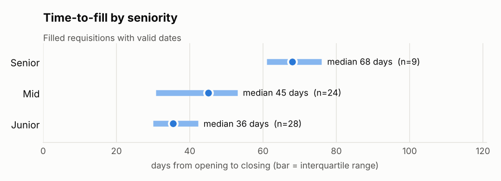
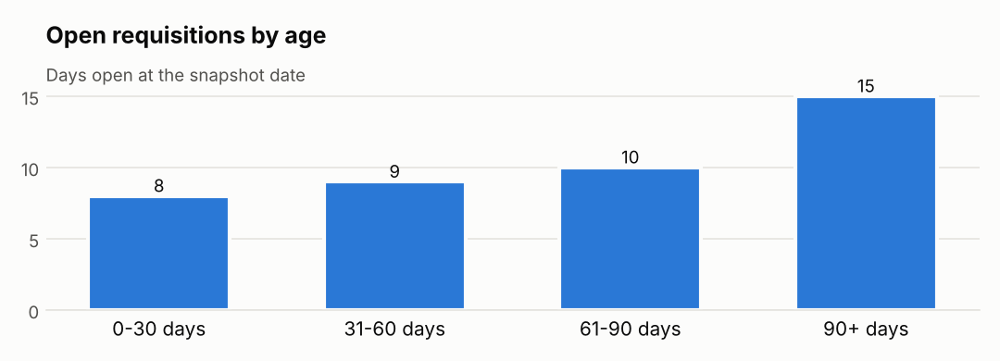

# recruiting-data-pipeline

> **Messy, multi-source recruiting data in; KPIs you can defend out.** Every data-quality check is tested against defects planted with a known count, so the numbers are trusted by construction, not by eyeballing.

Python · SQL (DuckDB) · pandera · pytest · GitHub Actions. **All data is synthetic.**

**In 30 seconds**

- **9 of 9** data-quality defect types are found exactly as planted, for any seed, and a clean dataset yields **zero** findings.
- KPIs are written in plain SQL and cross-checked against an independent pandas implementation (71 tests in CI).
- Results come with their uncertainty (95% Wilson intervals), and an **Objection** step tries to break the conclusions before anyone reads them.
- **[Case-study deck (PDF, 13 slides)](docs/deck/recruiting-pipeline-case-study.pdf)** · [90-second walkthrough and FAQ](docs/walkthrough.md) ([español](docs/walkthrough.es.md)) · [summary](docs/summary.md) · [validation report](docs/validation_report.md)

**Why this project exists.** In my data-intelligence internship I run a weekly pipeline that reconciles about 3,400 wellbeing alerts with 1,700 CRM cases before they feed a dashboard. That work and its data are confidential, so this repository rebuilds the *method* from scratch in a domain anyone can inspect: a recruiting funnel.



| | |
|---|---|
| **Question** | Where do candidates come from, where do they drop out, and how long do requisitions take to fill, when the data comes from systems that disagree? |
| **Pipeline** | content-based ingestion → schema + business-rule validation → cleaning with row-level flags → DuckDB model → KPIs in SQL → static report |
| **Trust** | every data-quality check is tested against defects planted with a known count; a clean dataset yields zero findings |
| **Outputs** | [case-study deck](docs/deck/recruiting-pipeline-case-study.pdf) ([.pptx](docs/deck/recruiting-pipeline-case-study.pptx)) · [summary](docs/summary.md) · [validation report](docs/validation_report.md) · [objection analysis](docs/objection.md) · [KPI tables](docs/kpis) · `docs/report.html` (self-contained page) |

The write-up follows **AXIOM**, the five-phase structure I use for analytical work:
**A**lcance (scope), e**X**ploración (exploration), **I**nferencia (inference),
**O**bjeción (objection) and **M**ensaje (message). The Objection phase exists to
attack my own conclusions before anyone else reads them.

---

## A · Scope

**Decisions this supports.** A recruiting lead allocating effort across sourcing channels, recruiters and open requisitions.

**KPIs.**

| KPI | Definition | Why this definition |
|---|---|---|
| Funnel conversion | applications that reached each stage ÷ previous stage | Uses the *furthest* stage reached, so a hire counts at every earlier stage |
| Source effectiveness | interview rate and hire rate per source, with 95% Wilson intervals | Small samples and rates near 0 make point estimates misleading on their own |
| Time-to-fill | days from opening to closing; median and interquartile range | Durations are skewed; a mean is pulled by a few slow searches |
| Open-requisition aging | days open at the snapshot date, in buckets | Shows the shape of the backlog, not just its size |
| Recruiter load | open requisitions, active candidates, CRM activity in the last 30 days | Separates workload from activity |

**Out of scope.** Candidate-level prediction, forecasting, and anything that would need personal data.

## X · Exploration: the data and what is wrong with it

Three systems export data that is supposed to describe the same candidates:

| Export | Rows | Grain |
|---|---:|---|
| `ats_requisitions_export.csv` | 120 | one row per requisition |
| `ats_candidates_export.csv` | 3,037 | one row per application (duplicates included) |
| `crm_export_01..06.csv` | 6,000 | one row per CRM activity, in six periodic exports |

The generator (`generate.py`, default seed 2027) plants **eight data-quality defects** in disjoint rows and records the exact count of each in a manifest. Validation runs in two layers: **pandera** for column-level schema checks and **hand-written business rules** for cross-field and cross-table logic. It must find exactly what was planted:

| Check | Layer | Planted | Found | Pipeline action |
|---|---|---:|---:|---|
| Renamed column in one CRM export (`activity_date`) | ingestion | 1 | 1 | WARN: mapped to the canonical name |
| Exact duplicate applications | rule | 37 | 37 | WARN: dropped, first occurrence kept |
| Source spelling variants (`Referido`, `linkedin`, …) | rule | 120 | 120 | WARN: mapped to the canonical source |
| CRM keys with wrong case, spaces or no hyphen | rule | 250 | 250 | WARN: normalized |
| Missing funnel stage | schema | 15 | 15 | ERROR: excluded from funnel KPIs |
| Hired without reaching the hired stage | rule | 9 | 9 | ERROR: excluded from funnel KPIs |
| Applied before the requisition opened | rule | 21 | 21 | ERROR: excluded from funnel KPIs |
| Requisition closed before it opened | rule | 6 | 6 | ERROR: excluded from time-to-fill |
| CRM activity pointing to no application | rule | 44 | 44 | ERROR: excluded from activity KPIs |

**WARN** means the fix is deterministic and safe. **ERROR** means the row cannot be trusted: it is flagged, logged and kept out of KPIs, never "fixed" by guessing. The only deletion in the whole pipeline is exact duplicates, and it is logged too.



## I · Inference: what the KPIs say

Snapshot: 2026-10-12. Funnel figures use **filled requisitions**, where outcomes are final.

| KPI | Value |
|---|---:|
| Applications on filled requisitions | 1,546 |
| Applied → interview | 37.1% |
| Applied → hired | 6.9% |
| Median time-to-fill | 41 days (IQR 31–50) |
| Best source by interview rate | Referral, 53% (95% CI 46%–59%) |
| Open requisitions older than 90 days | 15 of 42 |



**Referrals reach the interview stage more often than any other source, and the intervals do not overlap.** Among the other five sources the intervals overlap, so ranking them would be reading noise.



**Time-to-fill grows with seniority** (median 36 → 45 → 68 days). Differences by area and city ([table](docs/kpis/time_to_fill.csv)) rest on small groups (3 to 32 requisitions, most under 15) and should not be acted on.



> **Synthetic data, planted signals.** Because the data is generated, two real effects were planted on purpose: referrals progress further in the funnel, and senior roles take longer to fill. The tests assert that the analysis **recovers** both and does **not** find differences among the other sources, where none were planted. That is how this repo checks its analysis in both directions; the numbers themselves describe the generator, not any real company.

## O · Objection: does the pipeline change any answer?

The same metrics, computed on the raw exports (naive) and on the cleaned data (pipeline):

| Metric | Naive | Pipeline |
|---|---:|---:|
| Applications counted | 3,037 | 2,955 |
| Distinct source labels | 19 | 6 |
| Source labels with < 30 applications | 13 | 0 |
| Hire rate (filled requisitions) | 7.3% | 6.9% |
| Median time-to-fill | 40 days | 41 days |
| Minimum time-to-fill | **−12 days** | 17 days |
| CRM activities linked to an application | 95.1% | 99.3% |

**Honest reading.** Headline rates barely move, because the defects touch about 3% of rows. What the pipeline changes is *structure*: one channel is no longer split into 19 labels, impossible durations disappear, and CRM activity is linked to the right candidates. A naive analysis would not be very wrong on averages. It would be wrong on rankings, minimums and joins, and nobody would notice.

**Other ways these conclusions could be wrong:**

- **Cohort choice.** On all applications, offer → hire conversion is 29%; on filled requisitions it is 41%. Candidates of open requisitions are still in process, so mixing them in understates conversion.
- **Hire rate is capped by openings** (one to three per requisition), so per-source hire rates are noisy. Interview rate is the more informative signal at this volume.
- **Time-to-fill is right-censored.** It uses filled requisitions only, so the slowest searches (15 requisitions still open after 90 days) are not in the median, and the reported 41 days is optimistic. Survival analysis (Kaplan–Meier, with open requisitions as censored observations) is the right next step.
- **What the generator does not model:** fuzzy duplicates (the same person with a different email), candidates re-applying, requisitions re-opened after closing, and time zones. Real exports would need rules for each.
- **The snapshot date is data-driven** (the latest event in the data), so KPIs are reproducible. A production version would take it as a parameter.

## M · Message

For a recruiting lead, in three lines (read as a demonstration: the data is synthetic):

1. **Invest in referrals.** They reach interviews about 1.4× as often as any other channel, and the difference is statistically clear.
2. **Plan senior searches at about two months.** That is nearly twice a junior search; set expectations with clients at opening, not at week six.
3. **Review the 15 requisitions open for more than 90 days.** That is more than a third of the open backlog.

And for whoever owns the data: the CRM export format changed once in six exports, and 4% of CRM activity was silently unlinkable before normalization. Both are cheap to fix at the source.

---

## How to run

```bash
pip install -e ".[dev]"
recruiting-pipeline run --raw data/raw --out reports        # generates the data if missing
recruiting-pipeline run --raw data/raw --out reports --bi   # + model tables as CSV for BI tools
pytest
```

Outputs go to `reports/`. The committed `docs/` folder is produced by `recruiting-pipeline run --out docs --bi`, and CI checks that every text output (Markdown, JSON, CSV) reproduces byte for byte.

## How it is tested

| What | How |
|---|---|
| Validation finds exactly what is there | planted defects with known counts, for five different seeds |
| No false positives | a clean dataset (no defects) must yield zero findings |
| SQL is correct | funnel, source effectiveness and time-to-fill recomputed independently in pandas |
| Statistics are correct | Wilson intervals checked against the closed-form formula |
| The analysis finds real effects and ignores noise | planted signals recovered; no difference among unplanted sources |
| Reproducibility | two independent runs produce identical text outputs |

## Project layout

```
src/recruiting_pipeline/
  config.py      data contract: columns, categories, sizes, planted defects
  generate.py    seeded synthetic generator + ground-truth manifest
  ingest.py      content-based table detection, schema-drift mapping, lineage
  schemas.py     pandera schemas (column-level checks)
  rules.py       business rules as reusable masks (validation and cleaning share them)
  normalize.py   source and key normalization
  validate.py    validation orchestration and report
  clean.py       deterministic fixes, row-level flags, data-quality log
  warehouse.py   DuckDB model and KPI runner
  sql/           model.sql + one file per KPI
  objection.py   naive vs pipeline comparison
  report.py      figures, summary, self-contained HTML report
  pipeline.py    end-to-end run
tests/           ground truth, SQL vs pandas, planted signals, reproducibility
docs/            committed outputs of the default run
docs/deck/      case-study deck (.pptx + .pdf); every number in it comes from docs/
docs/walkthrough.md   90-second overview + FAQ (general and technical), also in Spanish
docs/bi/        model tables as CSV (input of the Power BI layer)
powerbi/        Power BI layer: build guide, DAX measures, reconciliation table, theme
```

## About this project

Code and documentation developed with AI assistance (Claude); problem framing, design decisions and validation are my own.

License: MIT.
